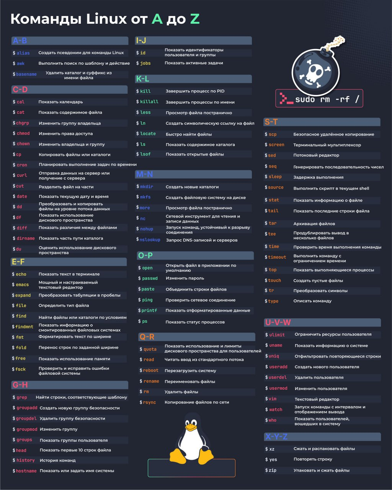

# Основные команды Linux от А до Я

Шпаргалка с основными командами терминала Linux.

---

## A-B

- **`alias`** — Создать псевдоним для команды Linux
- **`awk`** — Выполнить поиск по шаблону и действие
- **`basename`** — Удалить каталог и суффикс из имени файла

## C-D

- **`cal`** — Показать календарь
- **`cat`** — Показать содержимое файла
- **`chgrp`** — Изменить группу владельца
- **`chmod`** — Изменить права доступа
- **`chown`** — Изменить владельца и группу
- **`cp`** — Копировать файлы или каталоги
- **`cron`** — Планировать выполнение задач по времени
- **`curl`** — Отправка данных на сервер или получение с сервера
- **`cut`** — Разделить файл на части
- **`date`** — Показать текущую дату и время
- **`dd`** — Преобразовать и копировать файлы на уровне по-байтно
- **`df`** — Показать использование дискового пространства
- **`diff`** — Показать различия между файлами
- **`dirname`** — Показать часть пути каталога
- **`du`** — Оценить использование дискового пространства

## E-F

- **`echo`** — Показать текст в терминале
- **`emacs`** — Мощный и настраиваемый текстовый редактор
- **`expand`** — Преобразовать табуляции в пробелы
- **`file`** — Определить тип файла
- **`find`** — Найти файлы или каталоги по условиям
- **`findmnt`** — Показать информацию о смонтированных файловых системах
- **`fmt`** — Форматировать текст по ширине
- **`fold`** — Перенос строк по заданной ширине
- **`free`** — Показать использование памяти
- **`fsck`** — Проверить и исправить ошибки файловой системы

## G-H

- **`grep`** — Найти строки, соответствующие шаблону
- **`groupadd`** — Создать новую группу безопасности
- **`groupdel`** — Удалить группу безопасности
- **`groupmod`** — Изменить группу
- **`groups`** — Показать группы пользователя
- **`head`** — Показать первые 10 строк файла
- **`history`** — История команд
- **`hostname`** — Показать или задать имя системы

## I-J

- **`id`** — Показать идентификаторы пользователя и группы
- **`jobs`** — Показать активные задачи

## K-L

- **`kill`** — Завершить процесс по PID
- **`killall`** — Завершить процессы по имени
- **`less`** — Просмотр файла постранично
- **`ln`** — Создать символическую ссылку на файл
- **`locate`** — Быстро найти файлы
- **`ls`** — Показать содержимое каталога
- **`lsof`** — Показать открытые файлы

## M-N

- **`mkdir`** — Создать новые каталоги
- **`mkfs`** — Создать файловую систему на диске
- **`more`** — Просмотр файла постранично
- **`nc`** — Сетевой инструмент для чтения и записи данных
- **`nohup`** — Запуск команд, устойчивый к разрыву соединения
- **`nslookup`** — Запрос DNS-записей и серверов

## O-P

- **`open`** — Открыть файл в приложении по умолчанию
- **`passwd`** — Изменить пароль
- **`paste`** — Объединить строки файлов
- **`ping`** — Проверить сетевое соединение
- **`printf`** — Показать отформатированные данные
- **`ps`** — Показать статус процессов

## Q-R

- **`quota`** — Показать использование и лимиты дискового пространства для пользователей
- **`read`** — Читать ввод из стандартного потока
- **`reboot`** — Перезагрузить систему
- **`rename`** — Переименовать файлы
- **`rm`** — Удалить файлы
- **`rsync`** — Копирование файлов по сети

## S-T

- **`scp`** — Безопасное удалённое копирование
- **`screen`** — Терминальный мультиплексор
- **`sed`** — Потоковый редактор
- **`seq`** — Генерировать последовательность чисел
- **`sleep`** — Задержка выполнения
- **`source`** — Выполнить скрипт в текущем shell
- **`stat`** — Показать информацию о файле
- **`tail`** — Показать последние строки файла
- **`tar`** — Архивировать файлов
- **`tee`** — Продублировать вывод в несколько файлов
- **`time`** — Проверить время выполнения команды
- **`timeout`** — Выполнить команду с ограничением времени
- **`top`** — Показать выполняющиеся процессы
- **`touch`** — Создать пустые файлы
- **`tr`** — Преобразовать символы
- **`type`** — Описать команду

## U-V-W

- **`ulimit`** — Ограничить ресурсы пользователя
- **`uname`** — Показать информацию о системе
- **`uniq`** — Отфильтровать повторяющиеся строки
- **`useradd`** — Создать нового пользователя
- **`userdel`** — Удалить пользователя
- **`usermod`** — Изменить пользователя
- **`vim`** — Текстовый редактор
- **`watch`** — Запуск команды с интервалом и отображением вывода
- **`who`** — Показать пользователей, вошедших в систему

## X-Y-Z

- **`xz`** — Сжать и распаковать файлы
- **`yes`** — Повторять строку
- **`zip`** — Упаковать и сжать файлы
